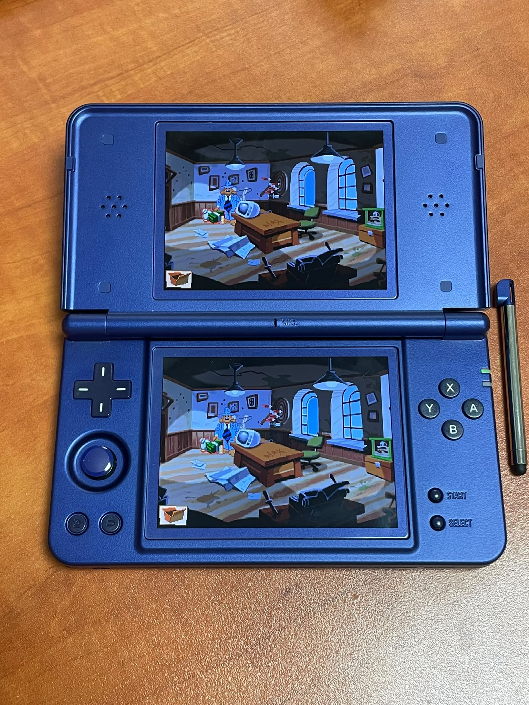
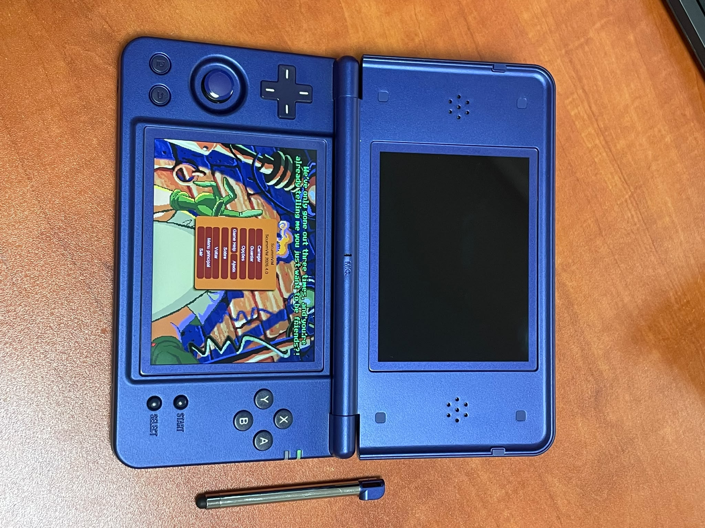
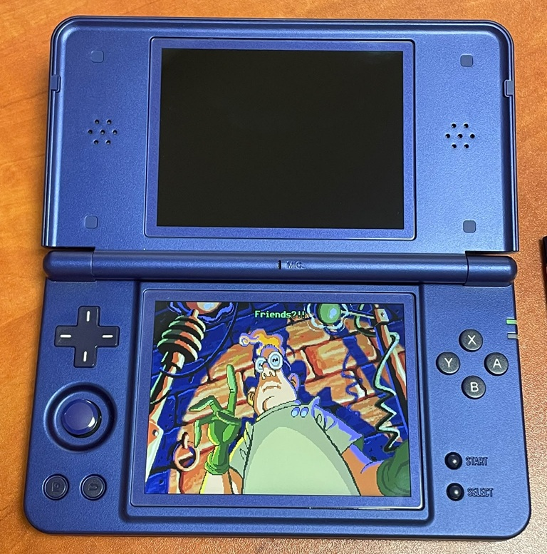
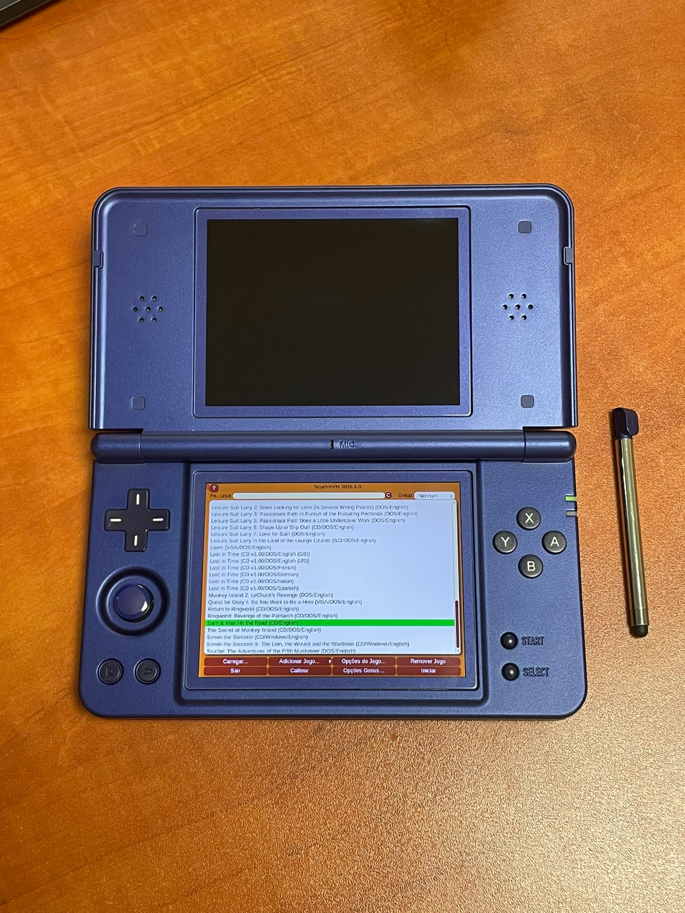
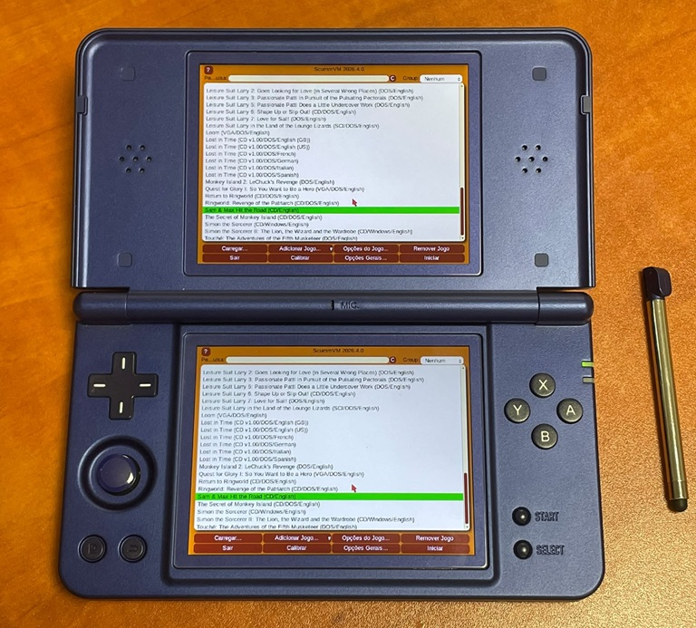

[⬇ Descarregar / Download](https://github.com/PolluxPT/ScummVM-RGDSPlus/releases/latest)

# ScummVM for Anbernic RG DS+

[Documentação em Português](README.md)

Standalone **ScummVM 2026.4.0** for **RG DS Plus running Linux Stock OS V1.0 (20260915)**. Modern GUI, lower-screen stylus/touch support, and a choice of mirrored displays or upper backlight off.

**Ready-to-play download:** open **Releases** and download **`ScummVM_RGDSPlus_v1.0.0.zip`**. The installation ZIP contains only `APPS`.

**Code → Download ZIP** and the automatic **Source code** downloads contain the development repository. To install, use the release asset named above. Programming knowledge is not required.

## Install or update

1. Extract `ScummVM_RGDSPlus_v1.0.0.zip` on your computer.
2. Copy **the contents of `APPS`** into `Roms/APPS` on the **TF2 / Games** card.
3. When updating, merge folders and replace supplied files. Keep your existing `ScummVM_RGDSPlus` directory, which holds your data.
4. On the console, open **APPS → ScummVM**. On first use, complete touch calibration and add your games.

The card will contain `Roms/APPS/ScummVM.sh`, `Roms/APPS/ScummVM_RGDSPlus/`, and the icon at `Roms/APPS/Imgs/ScummVM.png`.

[English guide](docs/INSTALL_EN.md) · [Guia PT](docs/INSTALACAO_PT.md)

## Features

- Standalone application, without RetroArch; modern GUI and 113 plugins, including detection.
- Lower-screen touch/stylus input, first-use calibration and **Calibrar** button in the GUI.
- **Lower screen only:** upper backlight set to zero during the session.
- **Mirror both screens:** same picture on both panels; touch remains on the lower screen. The upper copy is capped at 20 frames/s and may reduce performance, particularly in 3D.
- Persistent **Idioma / Language — PT / EN** button at startup. The ScummVM GUI language is selected separately in its Global Options.
- Physical volume buttons and a gentle quadratic curve: `0.35 × (Stock level / 10)²`. Level 0 is silent; maximum gain is 35% of the signal.
- One `ScummVM_RGDSPlus/ScummVM_Arranque.txt` log, overwritten on each launch.
- Maintainer-supplied icon at `APPS/Imgs/ScummVM.png`.

## Confirmed controls

| Control | Function |
| --- | --- |
| Stylus / touch | Lower-screen pointer and interaction |
| R2 | ScummVM menu |
| L2 | Virtual keyboard |
| Select | Original Sam & Max menu; game-dependent |
| D-pad | Movement in Grim Fandango; game-dependent |
| Volume + / − | Session volume and saved Stock level |
| L + R | Exit observed with this Stock integration |

Sam & Max and Grim Fandango have been run on the test console. Compatibility and performance depend on the game; an included engine does not guarantee flawless support for every game it can detect.

## Compatibility and user data

Targets **RG DS+ / RG DS Plus and the Stock OS listed above**. Other models, the non-Plus RG DS, and other operating systems require validation/adaptation. This is not a universal package.

Use **Add Game** to point ScummVM at your game data. Commercial games are not included. Original game resolution and aspect ratio are preserved; each panel is 1024 × 768.

Calibration, preferences and the game list live in `ScummVM_RGDSPlus/config`; default saves live in `saves`. Game language depends on the game data. Display modes and touch were confirmed on hardware; the audio curve has automated ARM tests, and the PT/EN button has local state/rendering tests.

## Sources, licences and support

- Upstream ScummVM and credits: [scummvm.org](https://www.scummvm.org/).
- Port code, patches and build configuration: `Sources/`; shell scripts: `APPS/`.
- Complete sources, including the original upstream archive, are provided as the release asset **`ScummVM_RGDSPlus_v1.0.0_Sources.zip`**. Keep this archive on your computer.
- [Licence](LICENSE), [credits](CREDITS.md), [developer notes](docs/DEVELOPMENT_PT_EN.md).
- For a report, include firmware, game and release version, and attach `ScummVM_Arranque.txt` before launching again. Remove personal paths from the log if present.

Community adaptation; not an official ScummVM or Anbernic release.

## Samples

