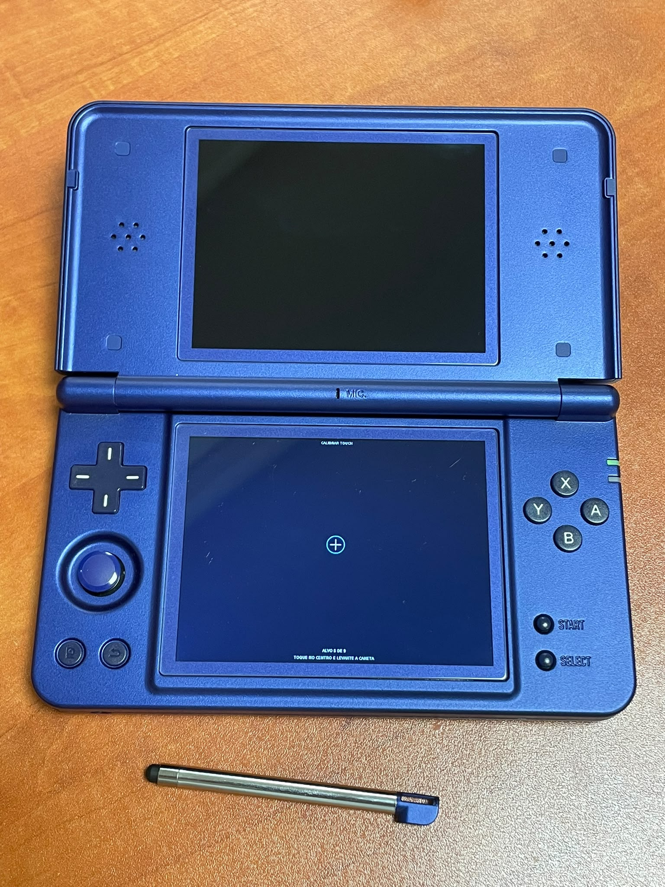
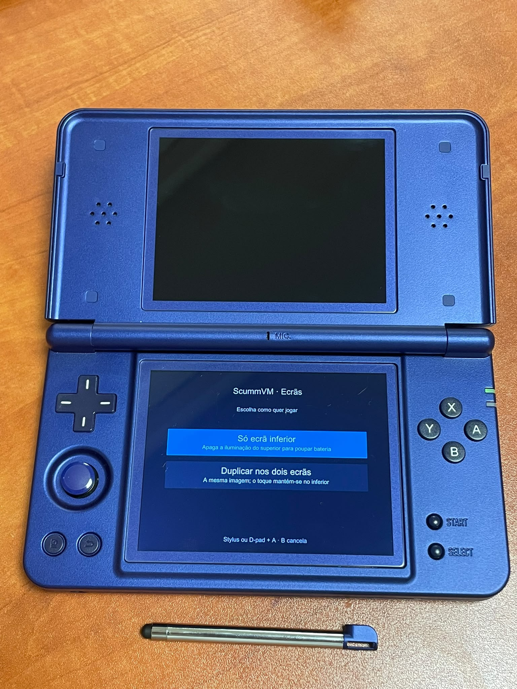

[⬇ Descarregar / Download](https://github.com/PolluxPT/ScummVM-RGDSPlus/releases/latest)

# ScummVM para Anbernic RG DS+

[English documentation](README.en.md)

ScummVM **2026.4.0**, como aplicação independente para a **RG DS Plus com Stock OS Linux V1.0 (20260915)**. Interface moderna, stylus/toque no ecrã inferior e escolha entre duplicação ou iluminação superior desligada.

**Download para jogar:** abre **Releases** e descarrega **`ScummVM_RGDSPlus_v1.0.0.zip`**. O ZIP de instalação contém apenas `APPS`.

O **Code → Download ZIP** e os ficheiros automáticos **Source code** contêm o repositório de desenvolvimento; para instalar, usa o ZIP indicado acima. Não são necessários conhecimentos de programação.

## Instalação e atualização

1. Extrai `ScummVM_RGDSPlus_v1.0.0.zip` no computador.
2. Copia **o conteúdo de `APPS`** para `Roms/APPS` do cartão **TF2 / Games**.
3. Numa atualização, une as pastas e substitui os ficheiros pedidos. Conserva a pasta existente `ScummVM_RGDSPlus`, que guarda os teus dados.
4. Na consola, abre **APPS → ScummVM**. Na primeira utilização, faz a calibração e adiciona os teus jogos.

No cartão ficam `Roms/APPS/ScummVM.sh`, `Roms/APPS/ScummVM_RGDSPlus/` e o ícone `Roms/APPS/Imgs/ScummVM.png`.

[Guia PT](docs/INSTALACAO_PT.md) · [English guide](docs/INSTALL_EN.md)

## Funcionalidades

- Aplicação independente, sem RetroArch; GUI moderno e recursos de 113 plugins, incluindo o de deteção.
- Toque/stylus no inferior, calibração inicial e botão **Calibrar** no GUI.
- **Só ecrã inferior:** iluminação do superior a zero durante a sessão.
- **Duplicar:** mesma imagem nos dois painéis; toque no inferior. A cópia superior tem limite de 20 imagens/s e pode reduzir desempenho, sobretudo em 3D.
- Botão **Idioma / Language — PT / EN** no arranque, com preferência guardada. O idioma do GUI ScummVM é escolhido nas suas Opções gerais.
- Botões físicos de volume e curva quadrática suave: `0.35 × (nível Stock / 10)²`. Nível 0 = silêncio; o máximo aplica 35% do sinal.
- Um único `ScummVM_RGDSPlus/ScummVM_Arranque.txt`, substituído em cada arranque.
- Ícone fornecido pelo responsável do projeto, incluído em `APPS/Imgs/ScummVM.png`.

## Controlos confirmados

| Controlo | Função |
| --- | --- |
| Stylus / toque | Cursor e interação no ecrã inferior |
| R2 | Menu do ScummVM |
| L2 | Teclado virtual |
| Select | Menu original em Sam & Max; depende do jogo |
| D-pad | Movimento em Grim Fandango; depende do jogo |
| Volume + / − | Volume da sessão e nível Stock guardado |
| L + R | Saída observada nesta integração Stock |

Sam & Max e Grim Fandango foram executados na consola de teste. A compatibilidade e o desempenho dependem do jogo; a presença de um motor não garante que todos os seus jogos funcionem sem problemas.

## Compatibilidade e dados

Preparado para **RG DS+ / RG DS Plus e o Stock OS indicado**. Outros modelos, RG DS sem Plus ou outros sistemas precisam de validação/adaptação. Não é um pacote universal.

Adiciona os dados dos teus jogos através de **Add Game / Adicionar jogo**. O pacote não inclui jogos comerciais. A resolução de origem e a proporção do jogo são preservadas; cada painel tem 1024 × 768.

Calibração, preferências e lista de jogos ficam em `ScummVM_RGDSPlus/config`; os saves por omissão em `saves`. O idioma dos jogos depende dos seus dados. O teste dos modos de ecrã e do toque foi confirmado no hardware; a curva de áudio tem testes ARM automatizados e o botão PT/EN tem testes de estado/renderização locais.

## Fontes, licenças e problemas

- ScummVM e respetivos créditos: [scummvm.org](https://www.scummvm.org/).
- Código do port, patches e configuração em `Sources/`; scripts em `APPS/`.
- As fontes completas, incluindo o arquivo upstream original, estão na release em **`ScummVM_RGDSPlus_v1.0.0_Sources.zip`**. Esse arquivo fica no computador.
- [Licença](LICENSE), [créditos](CREDITS.md), [notas de desenvolvimento](docs/DEVELOPMENT_PT_EN.md).
- Para reportar: indica o firmware, o jogo e a versão; anexa `ScummVM_Arranque.txt` antes de voltar a abrir a aplicação. Remove caminhos pessoais do registo se os houver.

Adaptação comunitária; não é uma release oficial do projeto ScummVM ou da Anbernic.

## Imagens

### samples

